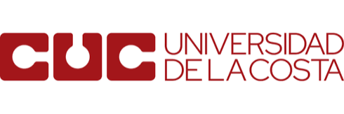

  <!-- Banner superior con tu paleta de colores -->
  
  
    
  
  <h2>¡Hola! Soy Andres Zea 👋</h2>
  
  
<i>"Convirtiendo el café en código y los problemas en soluciones."</i>

  <table align="center" style="border: none;">
    <tr>
      <td align="right"></td>
      <td align="left"><b>Ubicación:</b> Barranquilla, Colombia</td>
    </tr>
    <tr>
      <td align="right"></td>
      <td align="left"><b>Correo institucional:</b> azeat@cuc.edu.co</td>
    </tr>
  </table>
  

---

### 📌 Sobre mí
- 🎓 Estudiante de **4to Semestre de Ingeniería de Sistemas**.
- 💻 Apasionado por el desarrollo de software, la lógica y la creación de soluciones tecnológicas.
- 🚀 Actualmente enfocado en aprender, crear proyectos y dominar nuevas herramientas.
- ☕ Impulsado por el café y los buenos retos.

---

### 🏫 Mi Universidad

  
   
  <b>Universidad de la Costa (CUC)</b>
   
  <i>Ingeniería de Sistemas - 4to Semestre</i>

---

### 🛠️ Mi Tech Stack

  
  
  
  
  

 

  <!-- Banner inferior con tu paleta de colores -->
  

